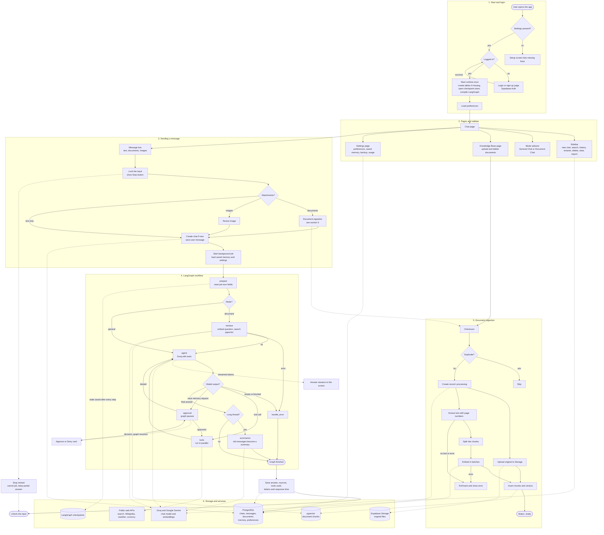

# IntelliChat AI

An AI assistant that chats, reads your documents and uses tools, all in one place.

IntelliChat AI is a conversational assistant built with Streamlit, LangChain, LangGraph and Google Gemini, with Supabase (PostgreSQL, pgvector, Storage and Auth) as its backend. It has two modes. General Chat handles everyday questions, coding help and step-by-step explanations, and calls tools when a task needs them, such as a calculator, web search, weather or currency conversion. Document Chat lets you upload PDF, TXT and DOCX files and ask questions about them, with answers that cite the file and page they came from.

Each conversation keeps its own memory, long chats are summarised automatically, and you can save facts to carry across chats. Anything that changes your saved data asks for your approval first. Answers stream in as they are written, and you can stop or regenerate them at any time. Accounts, chats, documents and memory are stored per user, so everything is still there after a restart. The same setup runs on a local Windows machine and on Streamlit Community Cloud.

## Features

- **Two chat modes**
  - **General Chat**: everyday questions, coding help and study help. The model decides from your message whether to answer directly, write code, teach step by step, or call a tool.
  - **Document Chat**: answers from your uploaded documents, with citations (file name and page). The same question can also use tools, for example a document fact plus today's date.
- **Streaming answers** with Markdown and code blocks, a **Stop** button, **Regenerate**, and copy/download for each answer. The input box is locked while an answer is being generated.
- **Chat history** in the sidebar (grouped by date, searchable, rename, delete, clear) and export to TXT/PDF.
- **Memory**: per-conversation memory through LangGraph PostgreSQL checkpoints, automatic summarising of long chats, and long-term facts you choose to save (view and delete them in Settings).
- **Documents**: PDF, TXT and DOCX upload from the chat box or the Knowledge Base page, duplicate detection by checksum, parallel processing, vectors in pgvector, originals in Supabase Storage.
- **Tools**: calculator, date and time, web search, Wikipedia, weather, currency, and save-to-memory (which asks for your approval first).
- **Images**: attach an image and ask about it.
- **Accounts**: email and password login through Supabase Auth; every query is filtered by the logged-in user.
- **Settings**: response length, temperature, max tokens, reply language, time zone, custom instructions, retrieval top-k, saved memory, JSON backup, usage and response-time statistics.
- **Optional** LangSmith tracing (off unless you set a key).


## Complete project workflow



**How to read it**
- Solid arrows show the order of steps. Dotted arrows show which service or storage a step uses.
- Documents added on the Knowledge Base page or in the chat box go through the same ingestion pipeline (section 5).
- In Document Chat the question is first matched against your documents (`retrieve`), and then the same `agent` node can still call tools, for example for the date or the web.

## Setup

### 1. Supabase

1. Create a project at https://supabase.com.
2. Open **SQL Editor**, paste all of `sql/schema.sql` and run it (the app also runs it on first start if the tables are missing).
3. **Project Settings → API**: copy the project URL, the `anon` key and the `service_role` key.
4. **Connect → Session pooler**: copy that connection string (port 5432) as `DATABASE_URL`. The direct connection is IPv6-only on the free plan and often fails.
5. **Authentication → Providers → Email**: for local testing you may turn off "Confirm email"; otherwise new users must click the link in the confirmation email first.

### 2. Run locally (Windows)

```bat
cd intellchat-ai
py -3.11 -m venv .venv
.venv\Scripts\activate
pip install -r requirements.txt
copy .env
python -m pytest -q
streamlit run app.py
```

Open http://localhost:8501, sign up, and start chatting. Stop the app with `Ctrl+C` and restart it after code changes.

### Environment variables

| Name | Required | Purpose |
|---|---|---|
| `GEMINI_API_KEY` | yes | Gemini key |
| `GROQ_API_KEY` | yes | Groq key |
| `DATABASE_URL` | yes | Supabase Session pooler connection string |
| `SUPABASE_URL`, `SUPABASE_ANON_KEY`, `SUPABASE_SERVICE_KEY` | yes | Auth and Storage |
| `CHAT_MODEL`, `EMBEDDING_MODEL` | no | defaults `gemini-3.8-flash`, `gemini-embedding-001` (confirm availability in Google AI Studio) |
| `CHAT_MODEL_OPTIONS` | no | extra model IDs for the Settings selector |
| `TAVILY_API_KEY` | no | better web search |
| `LANGSMITH_API_KEY` | no | tracing (LangSmith then receives prompts and answers) |
| `MIN_SIMILARITY` | no | retrieval cut-off, default 0.40 |
| `DB_POOL_SIZE` | no | database connections, default 5 |

Never commit `.env` or any key to GitHub (`.gitignore` already excludes it).
